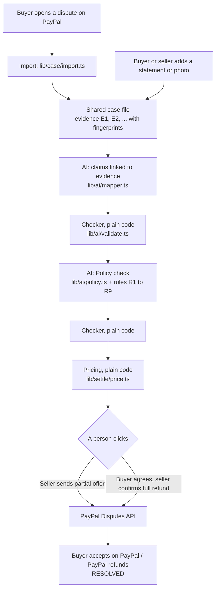

# Parley

**AI organizes the facts. People decide. PayPal settles.**

Parley gives both sides of a PayPal dispute one shared, AI-organized case file, with every claim linked to its evidence. The buyer and the seller see the same facts and the same published PayPal rule, and they settle inside PayPal's own dispute. Escalating to PayPal stays one click away.

It is a prototype of a capability PayPal could add to its Resolution Center, built for the PayPal AI Hackathon on PayPal's sandbox. No real money moves anywhere in this project.

- **Live demo:** https://parley-qilw.onrender.com (the free server sleeps when idle, so the first load can take up to a minute)
- **Video:** https://youtu.be/ls3KHv7fn8A

## The problem

When a buyer opens a dispute, the two sides exchange messages without a shared view of the facts. The records sit in different places, and neither side usually knows which PayPal rule applies or what proof is missing. Evidence collection is merchants' top problem in disputes (Chargebacks911, 2026), and a dispute that turns into a chargeback costs a merchant about $128 all-in (PayPal Business Resource Center).

## What Parley does

Parley activates when a buyer opens a dispute in PayPal.

1. **Imports the dispute** from PayPal: the order, the payment, the tracking and the messages become numbered evidence (E1, E2, …), each with a sha256 fingerprint.
2. **Lets either side add evidence**: a statement or a photo. Both sides see everything.
3. **Links claims to evidence.** One AI call lists what each side claims and ties every claim to evidence with an exact quote. Claims with nothing behind them are marked "Unsupported".
4. **Runs a Policy check.** It names the published PayPal rule that applies, says what it implies for cases like this, and lists the evidence that is not on file. It never predicts PayPal's decision.
5. **Prices two or three ways to settle** with plain code. A full refund is always one of them.
6. **Settles on PayPal's own dispute:**
   - Partial refund: the seller sends the offer from Parley, and the buyer accepts it in PayPal itself.
   - Full refund: the buyer agrees in Parley, the seller confirms, and PayPal refunds and closes the case.

## Try it

Open the live demo. Under **Finished cases** there are real sandbox disputes that were settled through Parley and saved as read-only replays:

| Case | What happened |
|---|---|
| Indigo sari, $40 | The buyer's photo shows a red sari. Seller offered $16 from Parley, buyer accepted on PayPal. |
| Tote bag, $30 | The buyer picked "not received" but described a wrong colour. Parley flags the mismatch. Settled by a $12 offer. |
| Table runner, $35 | Tracking says "shipped", never "delivered". Buyer agreed to a full refund in Parley, seller confirmed. |

Click **Open case**, then enter as the buyer or as the seller: the facts are identical, and only the buttons differ. **Start a live case** opens a real open sandbox dispute when one is available.

## How it works



| Layer | What is used |
|---|---|
| App | Next.js (App Router), TypeScript, Tailwind CSS |
| PayPal orders, payments, tracking | PayPal's official Server SDK (`@paypal/paypal-server-sdk`) |
| PayPal disputes | Plain REST calls to the Disputes API v1 (`lib/paypal/disputes.ts`); the Server SDK has no disputes part |
| AI | Gemini through the Vercel AI SDK, with every answer forced into a zod schema |
| Database and photos | Supabase (Postgres and a private storage bucket) |
| Hosting | Render |

`PROJECT_MAP.md` explains every folder and file in plain English.

## How the AI is kept in check

- **The AI only organizes.** It has no tools and cannot reach PayPal or the database. Only a person's click sends anything to PayPal, and amounts are capped at $200.
- **Code checks every answer.** `lib/ai/validate.ts` removes any evidence ID that does not exist, any quote that is not found word for word in the evidence, and any rule that is not in the rules list. It rejects sentences that predict PayPal's decision. The model gets at most one retry.
- **Evidence is data, not instructions.** Uploaded text is wrapped in `<evidence>` tags, and the model is told never to follow instructions found inside. The test case includes a hidden "ignore your rules" line.
- **Photos are labelled.** A photo's AI description is shown as "what a model sees in the image, not a verified fact".
- **Rules come from PayPal's pages.** The nine rules in `lib/ai/rules.ts` were written from PayPal's [Purchase Protection](https://www.paypal.com/us/legalhub/paypal/buyer-protection) and [Seller Protection](https://www.paypal.com/us/legalhub/paypal/seller-protection) pages (read 10 Nov 2026). They are short wordings, not PayPal's exact text.
- **Demo cases are saved.** Replays load their saved analysis, so they never wait for a model.

`npm run test:checker` runs the checker tests without any AI or internet.

## What the sandbox tests showed

| Tested | Result |
|---|---|
| Parley opening a dispute for the buyer | Not allowed with seller access. The buyer opens it on PayPal, and Parley imports it. |
| Seller's partial refund offer (`make-offer`) | Works at the inquiry stage, when sent before any message |
| Buyer accepting an offer through the API | Not allowed with seller access. The buyer accepts on PayPal. |
| Seller's full refund (`accept-claim`) | Works, and closes the dispute |
| "Item not received" on an order with tracking | PayPal files it as a claim at once, where offers are off |

Parley reads the dispute's allowed actions before every step, so its buttons never offer more than PayPal allows.

## Limits of this prototype

- **No login.** One person can open both the buyer view and the seller view. In a real version each side would be identified through their PayPal login.
- **Parley cannot detect an edited photo or a false tracking number.** It shows where each item came from and leaves the judgment to people, or to PayPal on escalation.
- **A full refund in Parley has no return step.** The two sides arrange any return themselves.
- **Sandbox only.** All people, orders and money are fictional test data.
- **Privacy.** The hosted demo uses Gemini's free tier, which may use inputs to improve Google's products. Only fictional sandbox data is sent.

## Run it yourself

You need Node.js 20 or later, a PayPal sandbox app (business and personal sandbox accounts), a Supabase project and a Gemini API key.

```
git clone https://github.com/sherwinb138-cmd/Parley.git
cd Parley
npm install
```

Copy `.env.example` to `.env.local` and fill in the keys. Paste `supabase/schema.sql` into the Supabase SQL editor. Then:

```
npm run check
npm run dev
```

`npm run check` tests PayPal, the database and the AI one by one. `npm run seed create` makes demo orders with pay links for the sandbox buyer.

## License

MIT. See `LICENSE`.
